# TP6 : Service Banque en CORBA

**Matière :** Développement d'applications réparties  
**Niveau :** LSI 3 1TP1, Faculté des Sciences de Sfax, 2026 – 2027  
**Réalisé par :** Nour Hbaieb*

---

## Objectif

Réaliser une application distribuée client-serveur en Java avec le middleware **CORBA** pour gérer des comptes bancaires. Le serveur expose les opérations suivantes :

- créer un compte avec un solde initial,
- verser une somme sur un compte (à partir de son code),
- retirer une somme d'un compte (à partir de son code),
- consulter un compte,
- consulter la liste de tous les comptes,
- convertir un montant d'Euro (€) en Dinar Tunisien (DT).

> Les captures d'écran se trouvent dans le dossier `images/` du dépôt.

---

## Étape 1 : Préparation de l'espace de travail

Le dossier de travail `votreNomPrenom_LSI3_DevAppReparties` contient les deux projets : `TP6_CorbaBanque_Server` et `TP6_CorbaBanque_Client`.

CORBA (`idlj`, `tnameserv`, `org.omg.*`) n'est disponible que jusqu'au **JDK 8**. Les deux projets utilisent donc **Amazon Corretto 1.8.0_512**. La commande `java -version` confirme que le JDK 8 est bien installé et configuré dans le `PATH`.

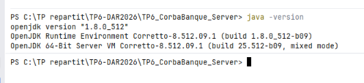

**Synthèse :** l'environnement est prêt, avec le JDK 8 actif et l'IDE IntelliJ IDEA.

---

## Étape 2 : Développement du serveur

### 2.1 Arborescence du projet serveur

Le projet `TP6_CorbaBanque_Server` contient les packages `corbaBanque` (code généré par `idlj`), `service` (le servant) et `corbaServer` (le serveur), ainsi que `Banque.idl` et `jndi.properties` dans `src`.

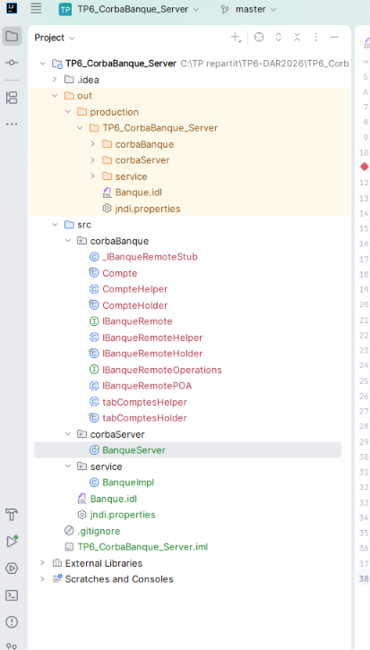

### 2.2 Interface IDL : `Banque.idl`

Le fichier IDL déclare :

- le module `corbaBanque`,
- la structure `Compte` (`code : long`, `solde : float`),
- le type `tabComptes` (séquence de `Compte`),
- l'interface `IBanqueRemote` avec les méthodes `creerCompte`, `verser`, `retirer`, `getCompte`, `getComptes` et `conversion`.

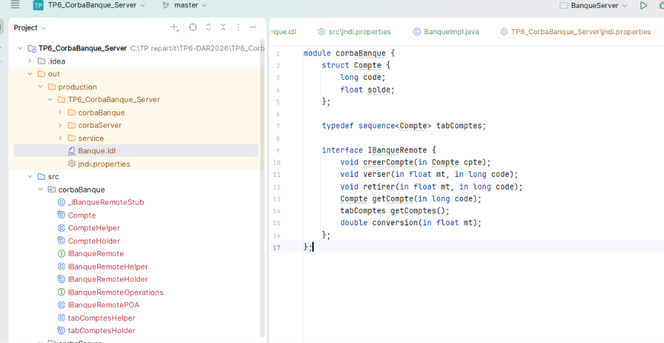

### 2.3 Compilation de l'IDL

La commande `idlj -fall -v Banque.idl`, exécutée dans le dossier `src`, génère le package `corbaBanque`.

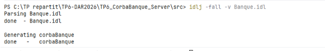

Fichiers générés : `Compte`, `CompteHelper`, `CompteHolder`, `IBanqueRemote`, `IBanqueRemoteOperations`, `IBanqueRemoteHelper`, `IBanqueRemoteHolder`, `IBanqueRemotePOA`, `_IBanqueRemoteStub`, `tabComptesHelper` et `tabComptesHolder`.

### 2.4 Implémentation du servant : `BanqueImpl`

La classe `BanqueImpl` hérite de `IBanqueRemotePOA` (le **skeleton**) et contient le code métier. Les comptes sont stockés dans une `HashMap<Integer, Compte>`, avec un taux de conversion fixe EUR → DT de 3,4.

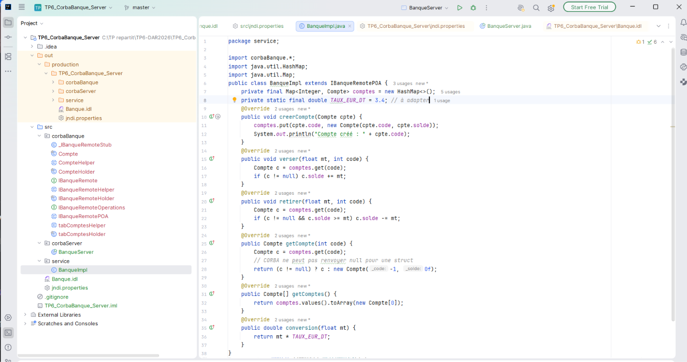

### 2.5 Configuration JNDI : `jndi.properties`

Ce fichier indique la fabrique de contexte (`CNCtxFactory`) et l'adresse de l'annuaire de noms CORBA (`iiop://localhost:900`).

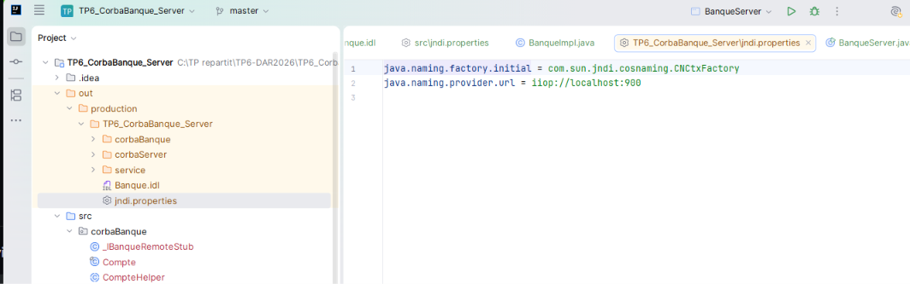

### 2.6 Le serveur : `BanqueServer`

La classe `BanqueServer` :

1. initialise l'**ORB**,
2. récupère le **RootPOA** et active le **POAManager**,
3. configure l'annuaire **JNDI**,
4. crée le servant `BanqueImpl`,
5. enregistre sa référence dans l'annuaire sous le nom `BanqueService` (`rebind`),
6. met l'ORB en attente des requêtes des clients (`orb.run()`).

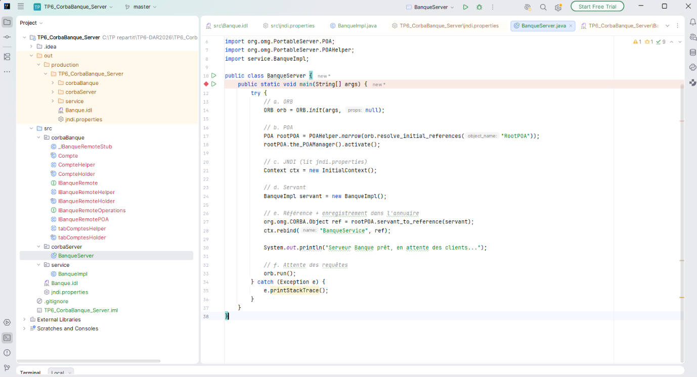

**Synthèse :** le serveur est complet. L'IDL définit le contrat, `idlj` génère le squelette et les classes utilitaires, et le servant implémente la logique métier.

---

## Étape 3 : Développement du client

### 3.1 Arborescence du projet client

Le projet `TP6_CorbaBanque_Client` reçoit une copie de `Banque.idl` et de `jndi.properties`. L'IDL y est recompilé pour générer le **stub** (`_IBanqueRemoteStub`) et les classes associées.

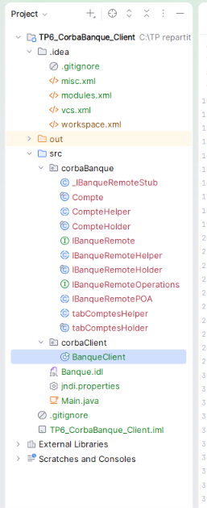

### 3.2 La classe `BanqueClient`

La classe `BanqueClient` :

1. charge les propriétés JNDI (`new InitialContext()`),
2. récupère la référence de l'objet distant (`ctx.lookup("BanqueService")`),
3. convertit la référence en `IBanqueRemote` avec `IBanqueRemoteHelper.narrow(...)`, ce qui crée le **stub**,
4. appelle à distance chacune des méthodes du service bancaire pour les tester.

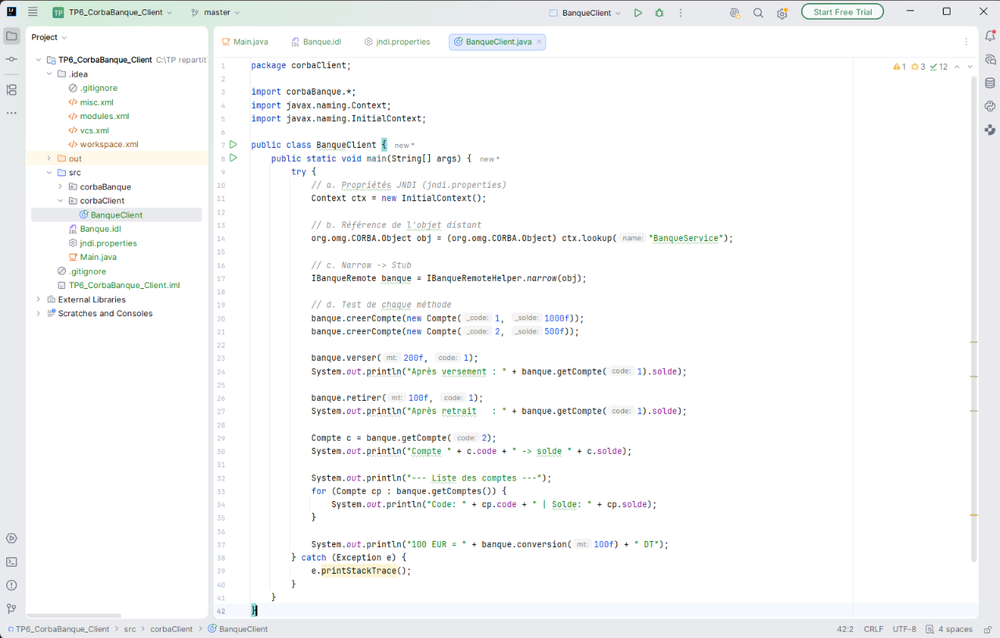

**Synthèse :** le client ne manipule que l'interface `IBanqueRemote`. Il ignore l'emplacement et l'implémentation réels de l'objet distant (transparence de la localisation).

---

## Étape 4 : Exécution de l'application

L'ordre de lancement est obligatoire : **annuaire → serveur → client**.

### 4.1 Lancement de l'annuaire (Naming Service)

La commande `tnameserv` démarre le service de noms CORBA sur le port **900**. Il affiche l'IOR du contexte initial et le message « Prêt. ».

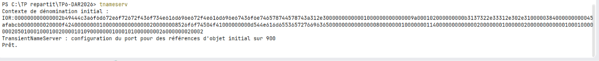

### 4.2 Lancement du serveur

L'exécution de `BanqueServer` affiche « Serveur Banque prêt, en attente des clients... ». Le serveur est enregistré dans l'annuaire et attend les requêtes.

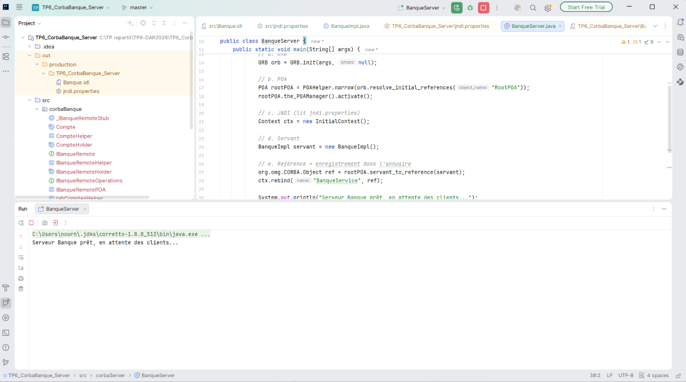

### 4.3 Lancement du client

L'exécution de `BanqueClient` donne le résultat suivant :

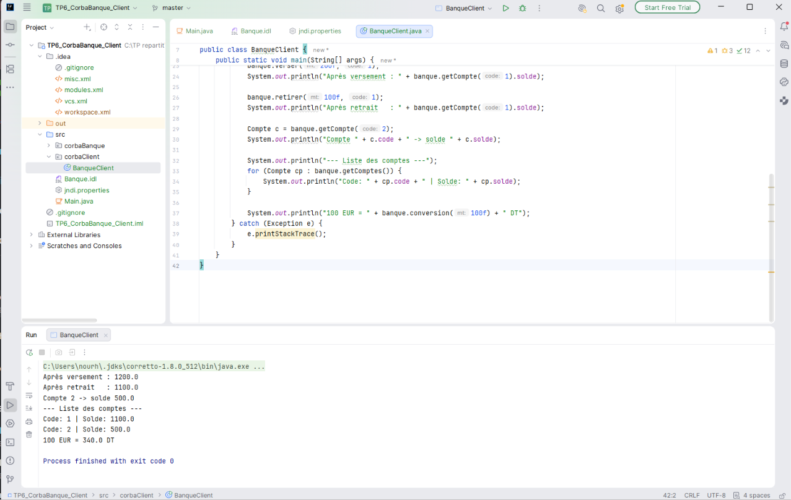

| Opération testée | Résultat obtenu |
|---|---|
| Création des comptes 1 (1000) et 2 (500) | OK |
| Versement de 200 sur le compte 1 | Solde = **1200.0** |
| Retrait de 100 du compte 1 | Solde = **1100.0** |
| Consultation du compte 2 | Solde = **500.0** |
| Liste des comptes | Compte 1 : 1100.0 / Compte 2 : 500.0 |
| Conversion de 100 EUR | **340.0 DT** |

**Synthèse :** les six opérations fonctionnent à travers le réseau CORBA. Le programme se termine avec le code de sortie 0, sans erreur.

---

## Synthèse générale

### Architecture CORBA

```
 Client                                                  Serveur
┌──────────────┐                                     ┌───────────────┐
│ BanqueClient │                                     │  BanqueImpl   │
│      │       │                                     │  (servant)    │
│   Stub       │                                     │      ▲        │
│      │       │                                     │  Skeleton/POA │
│     ORB  ────┼────────── IIOP (réseau) ────────────┼─►   ORB       │
└──────┬───────┘                                     └──────┬────────┘
       │  lookup("BanqueService")                           │ rebind(...)
       └───────────────►  Naming Service (tnameserv:900) ◄──┘
```

### Rôle de chaque composant

- **IDL** : langage neutre qui décrit le contrat (interface, types, méthodes) indépendamment du langage d'implémentation.
- **idlj** : compilateur IDL → Java. Il génère le stub, le skeleton (POA), les helpers et les holders.
- **ORB** : bus d'objets qui transporte les requêtes entre client et serveur via le protocole IIOP.
- **POA** : adaptateur d'objets côté serveur, qui active le servant et lui dirige les requêtes.
- **Stub** : mandataire local côté client, qui rend l'appel distant transparent.
- **Naming Service (`tnameserv`)** : annuaire qui associe un nom (`BanqueService`) à une référence d'objet distant.
- **JNDI** : API Java utilisée pour accéder à l'annuaire de noms de façon standard.

### Difficultés rencontrées et enseignements

- CORBA n'existe plus à partir du JDK 11 : il faut utiliser le **JDK 8** pour les deux projets.
- L'ordre de démarrage compte : annuaire, puis serveur, puis client.
- `jndi.properties` doit se trouver dans `src` pour être copié dans le dossier de sortie, sinon JNDI ne trouve pas sa configuration.
- Une `struct` IDL ne peut pas valoir `null` : `getCompte` renvoie donc un compte factice (`code = -1`) si le compte n'existe pas.
- Le TP m'a permis de comprendre le principe d'un appel de méthode à distance transparent et le rôle de l'IDL pour l'interopérabilité.